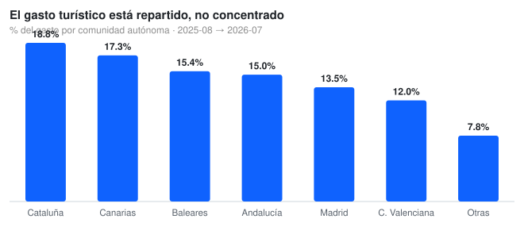
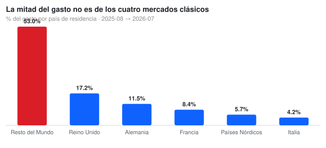
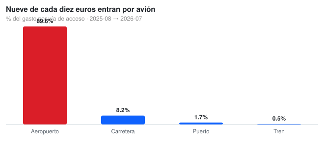

# ETL Egatur · Gasto turístico en España (INE)

**De dónde viene el gasto, dónde se queda y por dónde entra**

[](https://www.python.org/)
[](https://powerbi.microsoft.com/)
[](https://opensource.org/licenses/MIT)

---

## La pregunta de negocio

España recibe turismo de muchos mercados y no todos dejan el mismo dinero ni llegan por la misma puerta. La pregunta no es *cuánto se gasta* sino **de dónde viene ese gasto, dónde se queda y por dónde entra**, porque cada respuesta apunta a una decisión distinta: a qué mercado promocionar, qué comunidad atender y qué infraestructura priorizar.



---

## Qué dicen los datos

### El gasto está repartido, no concentrado

Cataluña **18,8 %**, Canarias **17,3 %**, Baleares **15,4 %**, Andalucía **15,0 %**, Madrid **13,5 %**, Comunidad Valenciana **12,0 %**. Ninguna comunidad llega al 20 %: siete destinos se reparten el 92 % del gasto, y el resto del país el 7,8 %. Para un negocio turístico eso significa que la decisión de dónde invertir no la resuelve la cuota por sí sola.

### Más de la mitad del gasto no viene de los cuatro mercados clásicos



Reino Unido **17,2 %**, Alemania **11,5 %**, Francia **8,4 %**, Nórdicos **5,7 %**, Italia **4,2 %** — y un **53,0 % agrupado en *Resto del Mundo***. La consecuencia incómoda: el mercado mayoritario es una caja negra. Cualquier campaña dirigida a "resto del mundo" está gastando a ciegas.

### Nueve de cada diez euros entran por avión



**89,6 % aeropuerto**, 8,2 % carretera, 1,7 % puerto, 0,5 % tren. Es el dato con más consecuencias operativas del conjunto: una huelga aérea o una caída de conectividad afecta a casi todo el negocio, y el mercado de carretera —el único que puede crecer sin depender de vuelos— aporta menos de una décima parte.

### Tendencia y motivo

- **+7,8 %** en enero-julio de 2026 frente al mismo tramo de 2025 (comparación de meses homólogos, no de año parcial contra año completo).
- **88,6 % del gasto es ocio**: 44,7 % ocio/recreo/vacaciones, 19,3 % sol y playa, 12,4 % otro ocio, 12,2 % cultural. Negocio y motivos profesionales, 2,8 %.

> Todos los cortes usan la misma ventana de 12 meses (2025-08 → 2026-07) y se expresan como **cuota del total**, no como importes. El motivo del viaje se lee aparte porque la tabla del INE solo se publica por años.

---

## ⚠️ El detalle que hay que ver antes de sumar

El master mezcla **granularidades**: cuatro tablas son mensuales (`2026M07`) y la de motivo del viaje es **anual** (`2025`). Sumar la columna `valor` sin separarlas cuenta el mismo gasto dos veces y produce cifras infladas sin ningún error visible. El notebook lo comprueba en la primera celda y el pipeline filtra por granularidad antes de agregar.

Además, el CSV **no declara unidades**: el INE publica estas series en miles de euros, pero al no venir en columna no se puede verificar desde el fichero. Por eso el análisis trabaja con cuotas (porcentajes), que son invariantes a la unidad.

---

## Reproduce it

```bash
git clone https://github.com/Nicolenki7/ETL_Egatur_INE_Esp.git
cd ETL_Egatur_INE_Esp

python -m venv .venv && source .venv/bin/activate
pip install -r requirements.txt

python src/egatur_drivers.py    # the three SVG charts in this README
```

Los CSV del INE están versionados en `data/`, así que no se descarga nada.

---

## Repo layout

```
Egatur_Power_BI_project.ipynb        notebook: granularity check, shares, trend, findings
src/egatur_drivers.py                the three charts in this README (SVG)
src/egatur_analysis.py               extended exploratory charts (PNG)
src/svg_chart.py                     tiny dependency-free SVG bar chart generator
data/raw/*.csv                       the five INE tables as downloaded
data/processed/egatur_master_long.csv  unified long format (2,881 rows)
docs/img/*.svg                       charts used here
outputs/figures/*.png                extended figures
docs/report.html                     one-page visual report
Proyecto Egatur INE.pbix             Power BI dashboard
```

---

## Método

1. **Extracción.** Cinco tablas del INE descargadas como CSV (`data/raw/`), con su `table_id` y nombre de tabla.
2. **Unificación.** Todas se convierten a formato largo con las mismas columnas: `table_id`, `table_name`, `dimension`, `dimension_value`, `indicador`, `tipo_dato`, `periodo`, `periodo_parsed`, `valor`.
3. **Control de granularidad.** Se marca cada fila como mensual o anual y se analiza cada grupo por separado.
4. **Cuotas.** Para cada dimensión: suma del grupo / suma de la tabla en la misma ventana de 12 meses. Sin mezclar tablas entre sí.

---

## Limitaciones

- **Las tablas no se suman entre sí.** Son indicadores distintos de la misma encuesta; sumar gasto por país con gasto por comunidad duplica la cifra.
- **Granularidad mixta** (mensual + anual): hay que filtrar siempre antes de agregar, también en el modelo de Power BI.
- **Unidades no declaradas en el CSV**, de ahí la decisión de trabajar con cuotas.
- **`Resto del Mundo` (53 %) es una caja negra**: sin desagregar no se sabe qué mercados crecen dentro.
- Los datos llegan hasta **2026-07**, el último periodo de la extracción; no hay garantía de que sea el último publicado por el INE.

## 下一步 / Siguiente paso

Desagregar *Resto del Mundo* y cruzar país con comunidad autónoma para pasar de *dónde se gasta* a *qué campaña mover*. Ese cruce no existe en estas cinco tablas y requeriría otra descarga del INE.

---

## 📄 Licencia

MIT para el código de análisis. Los datos son públicos del INE y siguen sus condiciones de reutilización.
